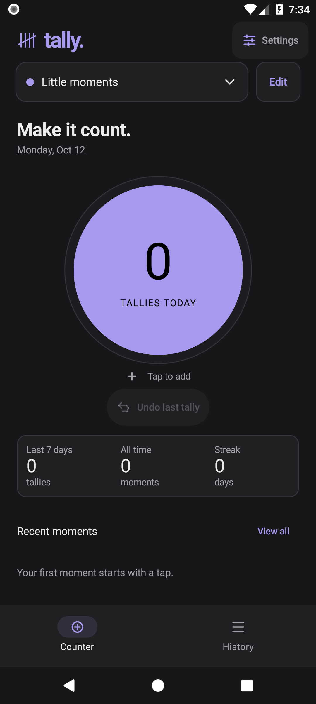
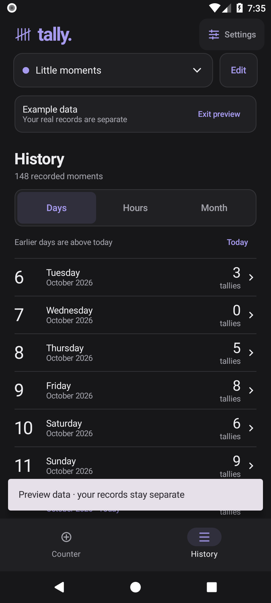
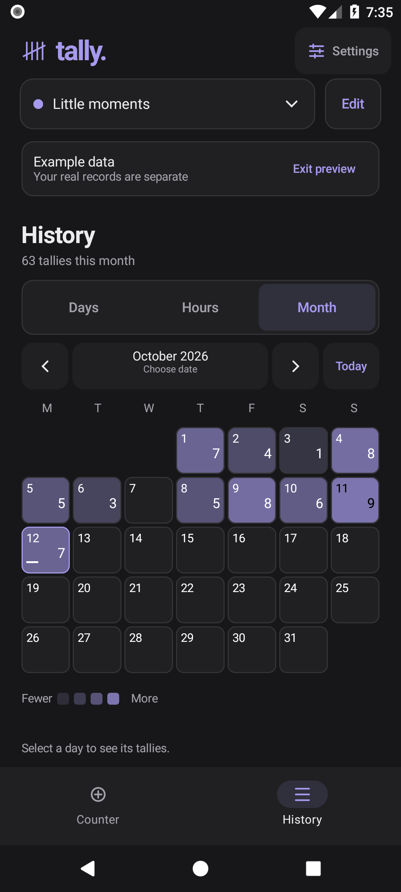

# VIBECODED APP THAT LETS YOU COUNT...

Tap to count anything. Create multiple tallies, swipe between them, and view daily and monthly history. Works offline, with custom colors, dark/light themes, undo, and backup/restore.

**[Download the Android APK](https://github.com/Vontk/tally-android/releases/latest)** · Android 8.0 or newer.

## Design

| Counter | History | Month |
| --- | --- | --- |
|  |  |  |

Screenshots from the native 1.1.0 design review. The current app also supports swiping between counters.

## Build

Native Kotlin and Jetpack Compose; no ads, accounts, or network permissions. With JDK 21 and Android SDK 37.2 installed, run `./gradlew assembleDebug assembleRelease bundleRelease`.

[Design handoff](docs/design/README.md) · [Release verification](VERIFICATION.md)
